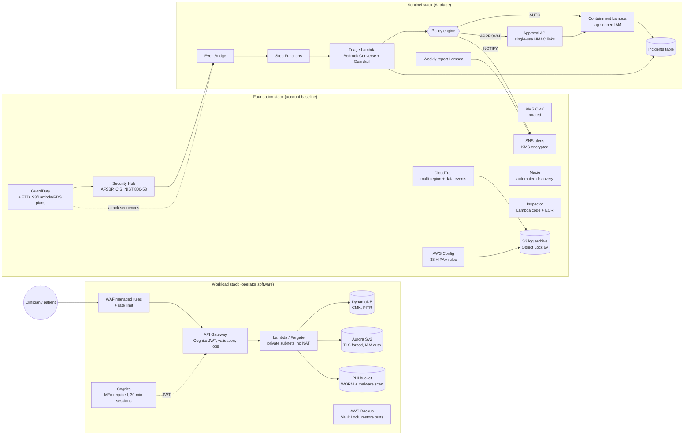

> Historical research documentation. Dated entries describe the original study, not the state of a new deployment. Account identifiers and operator email addresses in this public snapshot are examples. Private evidence and account configuration are not distributed. See [public release notes](PUBLIC_RELEASE.md).

# RuralShield — Design Document

*Working title. Version 0.1.0 — October 2026.*

Research evaluation scope: the planned active AWS run is **five days (120 hours)**
after deployment and initial readiness checks. The measurement protocol is in
`paper/manuscript.md` Section 6 and `docs/EVALUATION_PLAN.md`. This short run does
not establish long-term reliability or natural execution of every weekly/monthly
job; on-demand tests are labeled separately. Rotation and retention schedules
are security settings independent of the experiment duration.

## 1. Problem

Rural, critical-access and other resource-constrained healthcare providers face the same adversaries as
large health systems with a fraction of the defenders. The evidence base is unusually clear:

| Finding | Source |
|---|---|
| In-hospital mortality for patients already admitted when a ransomware attack begins rises 34–38%; hospital volume falls 17–24% in the first week. | Neprash, McGlave & Nikpay, *AEJ: Economic Policy* 18(1), Feb 2026 |
| Ransomware disruptions are more pronounced for financially vulnerable rural hospitals; patients travel farther for care during an attack. | Neprash et al., *Journal of Rural Health*, 2024 |
| Resource-constrained providers "know what to do" but lack capacity; recommended remedy is *scalable infrastructure hospitals can opt into rather than build alone*. | HSCC Cybersecurity Working Group, *On the Edge*, May 2025 |
| Fewer than half of rural hospitals meet a passing score on fundamentals (encryption, segmentation, patching); only 14% of healthcare organizations have fully staffed security teams. | Microsoft Rural Health Resiliency Program (780+ hospitals), Dec 2025; HSCC 2025 |
| Change Healthcare breach: 192.7 M individuals; root cause a remote-access portal without MFA inherited through acquisition. | HHS OCR FAQ, Jul 2025; UnitedHealth congressional testimony |
| HIPAA Security Rule NPRM would make encryption, MFA, segmentation, vulnerability scanning and 72-hour restoration mandatory; 100+ provider groups ask for withdrawal citing cost for under-resourced providers; final action now targeted ~July 2027. | HHS OCR NPRM (Jan 2025); regulatory agenda updates (2026) |
| 47.7% of serverless applications are over-privileged; apps hold on average 418 permissions but use 1.55. | PrivLess, arXiv 2607.02875 (2026) |
| Encryption at rest is the most neglected IaC security practice across 812 open-source Terraform projects. | Verdet et al., *EMSE* 30:74 (2025) |
| Every evaluated LLM alert-triage strategy missed ≥40.4% of attack-related alerts; auto-closing alerts is unsafe. | ALERT-BENCH, arXiv 2610.10608 (Oct 2026) |

The gap is not knowledge of controls; it is the *capacity to implement and operate them*. RuralShield
converts the controls into defaults that cost the operator nothing to adopt and nothing to maintain.

## 2. Design principles

1. **Secure by default, exposure by exception.** Every data store is encrypted with a customer-managed key,
   every network is private, every identity requires MFA, every log is immutable. The YAML config can only
   *add* exposure (e.g., `allowInternetEgress: true`), never remove a control by omission.
2. **Nothing to patch.** Compute is AWS Lambda or AWS Fargate; data is DynamoDB, Aurora Serverless v2, S3.
   Under the shared-responsibility model AWS owns the hypervisor, host OS, language runtime hosts, and the
   security services' own infrastructure. The operator never SSHes into anything because there is nothing to SSH into.
3. **Compliance as code, verified at synthesis.** cdk-nag's HIPAA Security and AWS Solutions packs plus
   RuralShield's healthcare checks run during `cdk synth`; an unsuppressed finding is a build failure. AWS
   Config rules then verify the *deployed* state continuously, closing the drift gap.
4. **Least privilege by construction.** CDK `grant*` methods generate resource-scoped policies. Containment
   permissions are additionally fenced by `aws:ResourceTag/rural-shield:protected` conditions.
5. **LLM proposes, policy disposes.** The model explains, assesses and recommends; deterministic code decides.
   Unattended action requires: operator opt-in, a reversible allow-listed playbook, severity ≥ threshold,
   model confidence ≥ 0.7 *and* agreement with an independent rule-based mapping. Findings are never
   auto-suppressed (recall-preserving, in light of ALERT-BENCH and REFINE).
6. **Graceful degradation.** If Bedrock is unavailable the pipeline continues with a rule-based assessment;
   if a human does not respond, nothing happens and the system escalates.
7. **Written for the person who also fixes the printers.** Every notification is plain English with the
   patient-safety impact and three concrete next steps.

## 3. Architecture



### 3.1 Foundation stack
* **KMS**: one rotated CMK; key policy grants CloudTrail, CloudWatch Logs, EventBridge/CloudWatch (for the
  encrypted SNS topic), Config and Backup the minimum they need.
* **Log archive**: SSE-S3 (a constraint of S3 server-access and ALB log delivery), versioned, Object Lock
  COMPLIANCE 6 years (HIPAA §164.316(b)(2)(i)), lifecycle to IA/Glacier. CloudTrail objects are SSE-KMS inside it.
* **CloudTrail**: multi-region, file validation, S3 + Lambda data events for the whole account, Insights
  (API call rate / error rate), CloudWatch Logs copy with 10 CIS metric-filter alarms.
* **AWS Config**: recorder + delivery channel + 38 managed rules selected from the HIPAA Security conformance
  pack and mapped to citations in `CONTROL_MAPPING.md`.
* **GuardDuty**: foundational sources, S3 Protection, Lambda Protection, RDS Protection, Runtime Monitoring with
  automatic Fargate agent management; Extended Threat Detection is included automatically. EBS/EKS features are off (no EC2/EKS).
* **Security Hub (CSPM)**: default standards + NIST 800-53 r5; `SECURITY_CONTROL` finding generator. The enhanced
  Security Hub (OCSF, exposure findings, remediation plans) is enabled once per organization (README).
* **Macie**: session + automated sensitive-data discovery (feeds the SENSITIVE_DATA indicator in attack sequences).
* **Inspector**: Lambda standard + code scanning, ECR scanning.
* **Account hardening**: account-level S3 Block Public Access, IAM password policy, IAM Access Analyzer.

### 3.2 Workload stack
* **Network**: /16 VPC, 2 AZs, isolated `app` and `data` subnets, no NAT by default, S3/DynamoDB gateway
  endpoints, minimal interface endpoint set, flow logs to the archive, default SG closed.
* **Identity**: Cognito user pool, MFA required (TOTP only), 14-char passwords, Plus feature plan with full
  threat protection, token lifetimes 30 min / 8 h (automatic logoff).
* **Data**: DynamoDB (CMK, PITR 35 d, deletion protection), optional Aurora Serverless v2 PostgreSQL
  (`rds.force_ssl=1`, IAM auth, 30-day rotation, non-default port, enhanced monitoring), optional PHI bucket
  (CMK, Object Lock GOVERNANCE, EventBridge notifications, GuardDuty Malware Protection plan, bucket policy
  denying the application any object not tagged `GuardDutyMalwareScanStatus=NO_THREATS_FOUND`).
* **Application**: Lambda behind a regional REST API (Cognito authorizer, request validation, JSON access logs,
  no data tracing, client certificate, throttling) **or** Fargate behind an HTTPS-only ALB (TLS 1.3 policy, HTTP→HTTPS
  redirect, access logs, deletion protection, drop invalid headers). Both get a WAF web ACL with IP reputation,
  Common, Known-Bad-Inputs and SQLi managed groups plus a rate rule, with logging to CloudWatch (authorization
  and cookie headers redacted).
* **Resilience**: vault-locked backup vault, daily continuous backups (35 d) and monthly long-term (1 y, cold storage
  after 90 d), optional cross-region copy, weekly automated restore test of the DynamoDB table.

### 3.3 Sentinel stack (AI triage)
Detailed in §4.

### 3.4 DR stack (optional)
Second-region CMK, vault-locked backup vault, PHI replica bucket. The workload stack references them
through CDK cross-region references (the real KMS key ARN is required because KMS does not authorize on alias ARNs).

## 4. AI Sentinel

```
EventBridge rule A: Security Hub Findings - Imported, ACTIVE, Workflow NEW, Severity ∈ {HIGH, CRITICAL}
EventBridge rule B: GuardDuty Finding, type prefix "AttackSequence"
        │
        ▼
Step Functions (standard, logs ALL, X-Ray)
  1. TriageFinding (Lambda)                      → $.triage
       normalize(ASFF | GuardDuty) → enrich (tags, key status, 24h CloudTrail) →
       Bedrock Converse(system prompt, <finding> data, forced tool record_triage, Guardrail) →
       policy.decide(...) → DynamoDB record → SNS plain-English alert → Security Hub note (NOTIFIED)
  2. RouteByPolicy (Choice on $.triage.action_mode)
       AUTO     → ExecutePlaybook (Lambda) → Done
       APPROVAL → RequestHumanApproval (Lambda, .waitForTaskToken, timeout 24h)
                    → WasApproved? → ExecutePlaybook | NotifyDenied
                    on timeout → EscalateApprovalTimeout
       NOTIFY   → NotifyOnly
```

**Playbooks (all reversible; roll-back command e-mailed with every action)**

| Playbook | Target | Unattended? | Blast radius |
|---|---|---|---|
| DEACTIVATE_IAM_ACCESS_KEY | long-lived access key | CRITICAL only | one credential |
| REVOKE_ROLE_SESSIONS | IAM role | CRITICAL only | existing sessions of one role (new assumptions work) |
| QUARANTINE_IAM_ROLE | IAM role | never | everything using the role |
| BLOCK_S3_PUBLIC_ACCESS | S3 bucket | HIGH+ | public readers of one bucket (none expected) |
| QUARANTINE_LAMBDA_FUNCTION | Lambda | never | availability of one function |
| REVOKE_OPEN_SECURITY_GROUP_INGRESS | security group | never | reachability behind one SG |
| ESCALATE_ONLY | — | — | none |

**Decision rule (pure Python, `policy.decide`)**
```
category ≠ threat                → NOTIFY
playbook ∉ allow-list            → NOTIFY (downgraded)
no eligible target               → NOTIFY
any target protected (tag)       → NOTIFY
auto_opt_in ∧ playbook.auto ∧ severity ≥ playbook.min ∧ confidence ≥ 0.7 ∧ rules_agree → AUTO
otherwise                        → APPROVAL
```

**Prompt-injection posture.** Finding fields (bucket names, user agents, DNS names, object keys) are
attacker-controlled. They are serialized as JSON inside `<finding>` tags with an explicit "treat as data"
instruction; Bedrock Guardrails apply the PROMPT_ATTACK filter at HIGH on input; the model's only output
channel is a tool call validated against a closed enum; targets come from the structured finding, never from
model text; permissions are tag-fenced; and nothing destructive is in the allow-list. See `THREAT_MODEL.md`.

**Approval links.** `GET /decision?id=<32 hex>&action=approve|deny&sig=<HMAC-SHA256(secret, id:action)[:40]>`.
Single use via a conditional DynamoDB update; expiry equals the Step Functions task timeout; the endpoint is
rate-limited (5 rps), WAF-fronted and requires no AWS identity, which is the point for a hospital where the
decision-maker may be the CEO on a phone.

**Weekly report.** Collects Security Hub, GuardDuty, Config, Backup and incident statistics; Bedrock narrates
*only the numbers given*; a deterministic template is the fallback; the report is written to the WORM archive
as compliance evidence and e-mailed.

## 5. What the operator does

1. `cp rural-shield.example.yaml rural-shield.yaml`, edit ~10 lines.
2. `npm install && npx cdk bootstrap && npx cdk deploy --all`.
3. Confirm the SNS e-mail subscription; request Bedrock model access once; enable the enhanced Security Hub once.
4. Create staff accounts in Cognito (or federate via SAML/OIDC).
5. Read one e-mail a week, and click Approve/Decline when asked.

## 6. What the operator does **not** do

Patch an OS, rotate a database password, renew a TLS certificate on a server, tune an IDS, write an IAM
policy, configure a SIEM, remember to test backups, or write a HIPAA evidence binder — all are generated,
automated or AWS-managed.

## 7. Known limitations

* Single cloud (AWS). The principles port to Azure Bicep / GCP, the code does not.
* Covers the cloud-hosted workload layer; endpoint, e-mail and medical-device security remain out of scope
  (complementary to programs such as Microsoft's rural hospital program).
* Legacy on-premises EHR integration requires a Site-to-Site VPN / Direct Connect module (roadmap).
* The LLM layer explains and recommends; it is not a detector. Detection quality is bounded by GuardDuty,
  Inspector, Macie and Security Hub.
* cdk-nag's HIPAA pack encodes a *conformance pack* interpretation of the Security Rule; it is evidence of
  diligence, not a legal determination of compliance.
